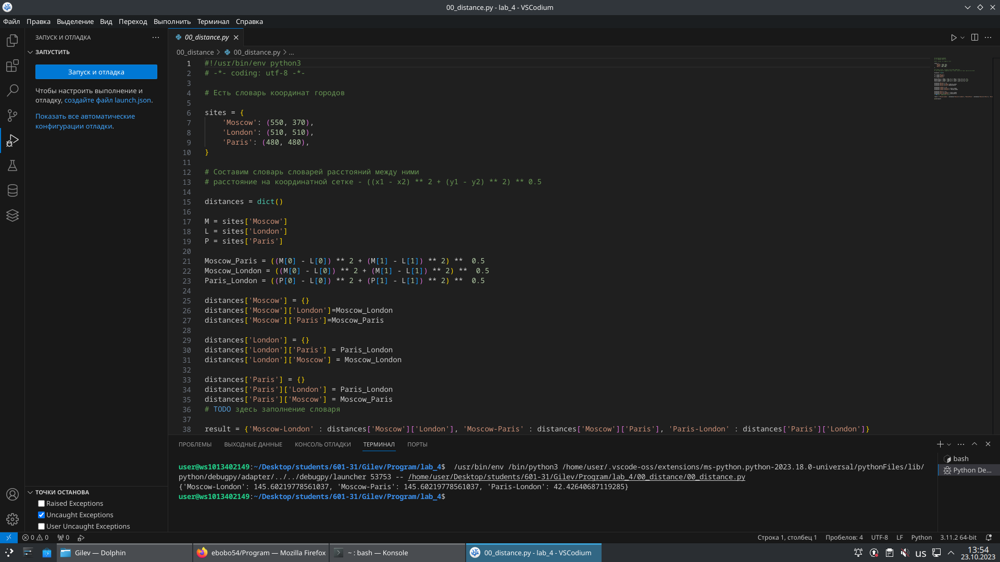
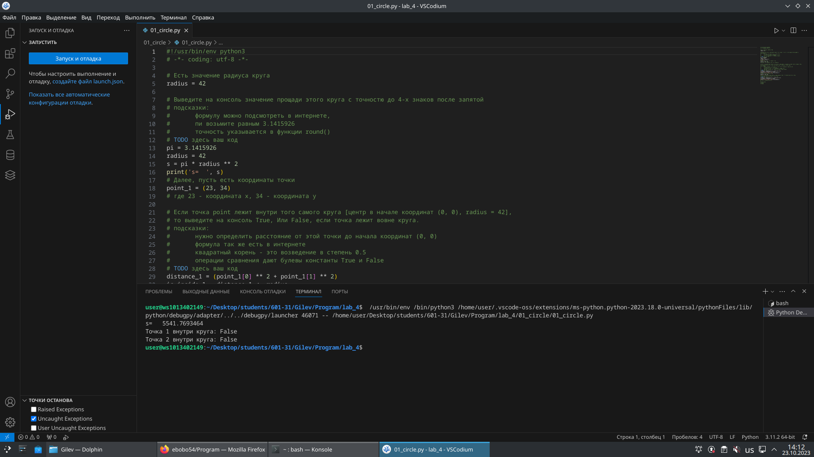
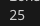
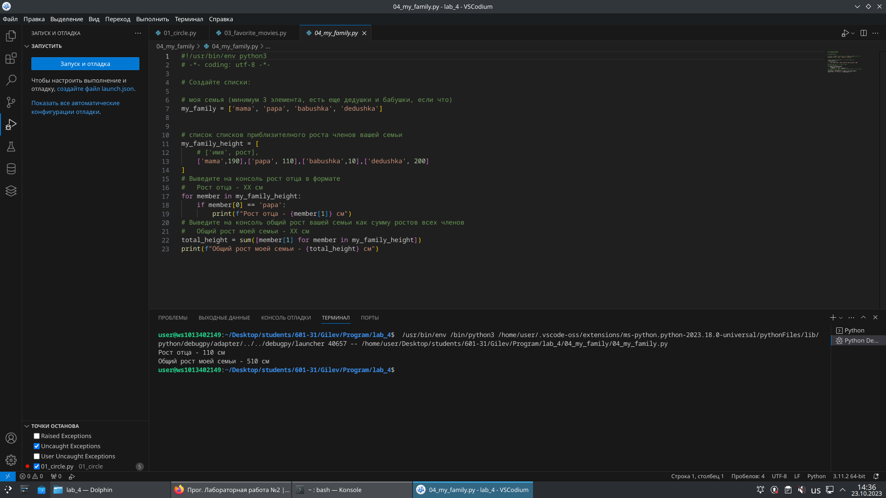
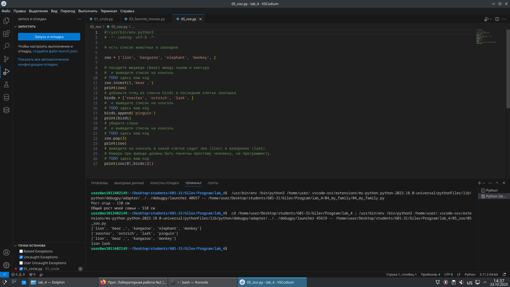
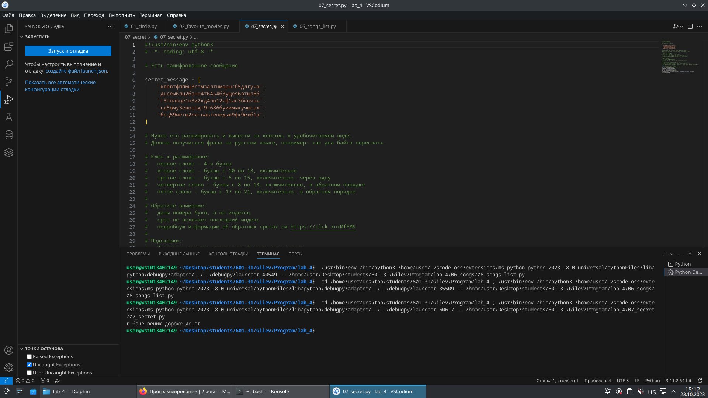
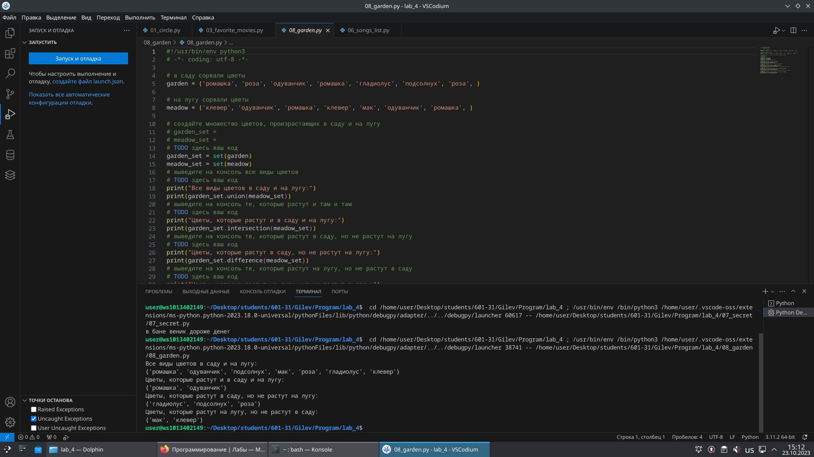
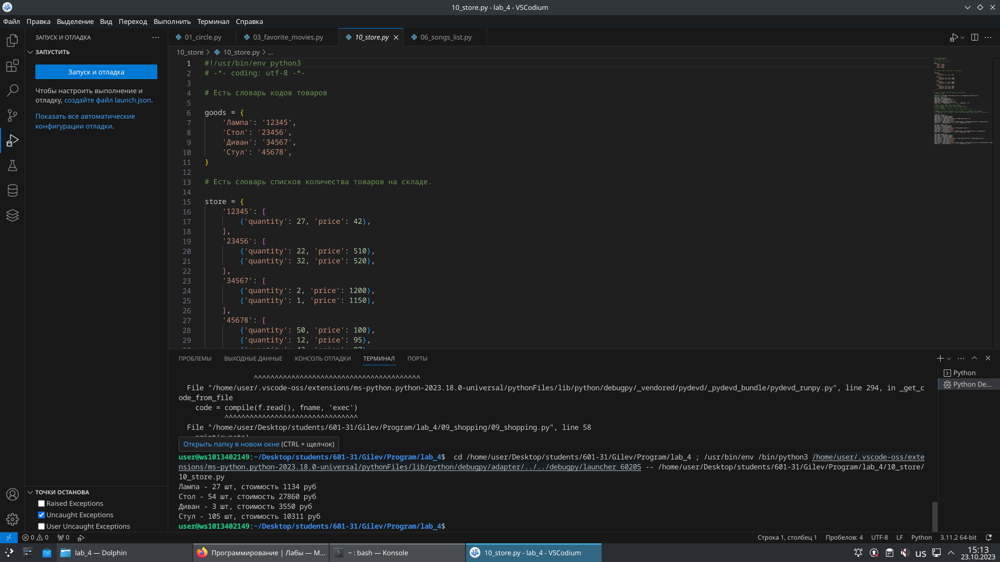

# lab_4
## Задание 
### 00_distance

```py
import math
import random
from collections import deque

class EquivalenceClustering:
    def __init__(self, epsilon):
        self.epsilon = epsilon
        self.users = {}  # {user_id: [session_time, clicks, frequency]}
        
    def add_user(self, user_id, features):
        """Добавление пользователя с его характеристиками"""
        self.users[user_id] = features
    
    def euclidean_distance(self, vec1, vec2):
        """Вычисление евклидова расстояния между двумя векторами"""
        if len(vec1) != len(vec2):
            raise ValueError("Векторы должны иметь одинаковую размерность")
        
        sum_sq = 0.0
        for i in range(len(vec1)):
            sum_sq += (vec1[i] - vec2[i]) ** 2
        return math.sqrt(sum_sq)
    
    def are_users_similar(self, user_id1, user_id2):
        """Проверка исходного отношения 'похож' (отношение толерантности)"""
        vec1 = self.users[user_id1]
        vec2 = self.users[user_id2]
        distance = self.euclidean_distance(vec1, vec2)
        return distance <= self.epsilon
    
    def build_equivalence_classes(self):
        """
        Построение классов эквивалентности R* 
        (транзитивное замыкание отношения 'похож')
        """
        user_ids = list(self.users.keys())
        visited = set()
        equivalence_classes = []
        
        for user_id in user_ids:
            if user_id not in visited:
                # Находим класс эквивалентности для текущего пользователя
                equivalence_class = self._find_equivalence_class(user_id, visited)
                equivalence_classes.append(equivalence_class)
        
        return equivalence_classes
    
    def _find_equivalence_class(self, start_user_id, visited):
        """
        Поиск класса эквивалентности с помощью BFS.
        Класс эквивалентности = все пользователи, достижимые через цепочки похожих.
        """
        equivalence_class = set()
        queue = deque([start_user_id])
        visited.add(start_user_id)
        
        while queue:
            current_user = queue.popleft()
            equivalence_class.add(current_user)
            
            # Ищем всех пользователей, похожих на текущего
            for other_user in self.users:
                if other_user != current_user and other_user not in visited:
                    # Проверяем исходное отношение "похож"
                    if self.are_users_similar(current_user, other_user):
                        visited.add(other_user)
                        queue.append(other_user)
        
        return equivalence_class
    
    def prove_equivalence_properties(self):
        """Доказательство свойств отношения эквивалентности R*"""
        print("=== ДОКАЗАТЕЛЬСТВО СВОЙСТВ ОТНОШЕНИЯ ЭКВИВАЛЕНТНОСТИ R* ===")
        print("Отношение R*: 'принадлежат к одному связному компоненту/классу эквивалентности'")
        print()
        
        # 1. Рефлексивность
        print("1. РЕФЛЕКСИВНОСТЬ:")
        print("   Для любого пользователя u: u R* u")
        print("   Доказательство:")
        print("   - Каждый пользователь достигается сам из себя тривиальной цепочкой длины 0")
        print("   - Следовательно, каждый пользователь принадлежит своему классу эквивалентности")
        print("   ✓ Свойство выполняется")
        print()
        
        # 2. Симметричность
        print("2. СИММЕТРИЧНОСТЬ:")
        print("   Для любых пользователей u, v: если u R* v, то v R* u")
        print("   Доказательство:")
        print("   - Если u R* v, то существует цепочка u = u₁, u₂, ..., uₙ = v")
        print("   - Так как отношение 'похож' симметрично, цепочку можно обратить: v = uₙ, uₙ₋₁, ..., u₁ = u")
        print("   - Следовательно, v R* u")
        print("   ✓ Свойство выполняется")
        print()
        
        # 3. Транзитивность
        print("3. ТРАНЗИТИВНОСТЬ:")
        print("   Для любых пользователей u, v, w: если u R* v и v R* w, то u R* w")
        print("   Доказательство:")
        print("   - Из u R* v: существует цепочка P₁: u = p₁, p₂, ..., pₖ = v")
        print("   - Из v R* w: существует цепочка P₂: v = q₁, q₂, ..., qₘ = w")
        print("   - Склеиваем цепочки: u = p₁, ..., pₖ = v = q₁, ..., qₘ = w")
        print("   - Получаем цепочку от u к w")
        print("   - Следовательно, u R* w")
        print("   ✓ Свойство выполняется")
        print()
        
        print("Все три свойства выполняются ⇒ R* - отношение эквивалентности ✓")
    
    def print_clustering_results(self, equivalence_classes):
        """Вывод результатов кластеризации"""
        print(f"\n=== РЕЗУЛЬТАТЫ КЛАСТЕРИЗАЦИИ ===")
        print(f"Порог похожести (epsilon): {self.epsilon}")
        print(f"Всего пользователей: {len(self.users)}")
        print(f"Найдено классов эквивалентности: {len(equivalence_classes)}")
        print()
        
        for i, eq_class in enumerate(equivalence_classes, 1):
            print(f"Класс эквивалентности {i}: {len(eq_class)} пользователей")
            print(f"  Состав: {sorted(eq_class)}")
            
            # Вычисляем средние характеристики класса
            avg_features = [0] * 3  # для трех характеристик
            for user_id in eq_class:
                features = self.users[user_id]
                for j in range(3):
                    avg_features[j] += features[j]
            
            for j in range(3):
                avg_features[j] /= len(eq_class)
            
            print(f"  Среднее время сессии: {avg_features[0]:.2f} мин")
            print(f"  Среднее количество кликов: {avg_features[1]:.2f}")
            print(f"  Средняя частота посещений: {avg_features[2]:.2f} раз/нед")
            print()

# Пример использования
def generate_test_data():
    """Генерация тестовых данных с тремя явными кластерами"""
    random.seed(42)
    users_data = {}
    
    # Кластер 1: Активные пользователи
    for i in range(1, 8):
        users_data[i] = [
            random.uniform(40, 60),  # session_time
            random.randint(20, 30),  # clicks
            random.uniform(4, 7)     # frequency
        ]
    
    # Кластер 2: Средние пользователи
    for i in range(8, 15):
        users_data[i] = [
            random.uniform(20, 40),
            random.randint(10, 20),
            random.uniform(2, 4)
        ]
    
    # Кластер 3: Пассивные пользователи
    for i in range(15, 21):
        users_data[i] = [
            random.uniform(5, 20),
            random.randint(1, 10),
            random.uniform(0.5, 2)
        ]
    
    return users_data

def main():
    # Генерируем тестовые данные
    users_data = generate_test_data()
    
    # Создаем объект кластеризации
    clustering = EquivalenceClustering(epsilon=15.0)
    
    # Добавляем пользователей
    for user_id, features in users_data.items():
        clustering.add_user(user_id, features)
    
    # Доказываем свойства отношения эквивалентности
    clustering.prove_equivalence_properties()
    
    # Выполняем кластеризацию (строим классы эквивалентности)
    equivalence_classes = clustering.build_equivalence_classes()
    
    # Выводим результаты
    clustering.print_clustering_results(equivalence_classes)
    
    # Демонстрация нарушения транзитивности исходного отношения
    print("=== ДЕМОНСТРАЦИЯ ПРОБЛЕМЫ ИСХОДНОГО ОТНОШЕНИЯ ===")
    print("Исходное отношение R: 'непосредственно похож' (d(u,v) ≤ ε)")
    print("Оно не является транзитивным:")
    
    # Ищем пример нарушения транзитивности
    user_ids = list(users_data.keys())
    for i in range(len(user_ids)):
        for j in range(i + 1, len(user_ids)):
            if clustering.are_users_similar(user_ids[i], user_ids[j]):
                for k in range(j + 1, len(user_ids)):
                    if (clustering.are_users_similar(user_ids[j], user_ids[k]) and 
                        not clustering.are_users_similar(user_ids[i], user_ids[k])):
                        print(f"Найден контрпример:")
                        print(f"  User {user_ids[i]} R User {user_ids[j]} (похожи)")
                        print(f"  User {user_ids[j]} R User {user_ids[k]} (похожи)")
                        print(f"  Но User {user_ids[i]} НЕ R User {user_ids[k]} (не похожи)")
                        return

if __name__ == "__main__":
    main()

```

```py
Есть словарь координат городов

sites = {
    'Moscow': (550, 370),
    'London': (510, 510),
    'Paris': (480, 480),
}

Составим словарь словарей расстояний между ними
расстояние на координатной сетке - ((x1 - x2) ** 2 + (y1 - y2) ** 2) ** 0.5

distances = {}

TODO здесь заполнение словаря

print(distances)
```

### 01_circle
```py
 Есть значение радиуса круга
radius = 42

Выведите на консоль значение прощади этого круга с точностю до 4-х знаков после запятой
 подсказки:
       формулу можно подсмотреть в интернете,
       пи возьмите равным 3.1415926
       точность указывается в функции round()
 TODO здесь ваш код


 Далее, пусть есть координаты точки
point_1 = (23, 34)
 где 23 - координата х, 34 - координата у

 Если точка point лежит внутри того самого круга [центр в начале координат (0, 0), radius = 42],
 то выведите на консоль True, Или False, если точка лежит вовне круга.
 подсказки:
       нужно определить расстояние от этой точки до начала координат (0, 0)
       формула так же есть в интернете
       квадратный корень - это возведение в степень 0.5
       операции сравнения дают булевы константы True и False
 TODO здесь ваш код

 Аналогично для другой точки
point_2 = (30, 30)
 Если точка point_2 лежит внутри круга (radius = 42), то выведите на консоль True,
 Или False, если точка лежит вовне круга.
 TODO здесь ваш код
```

### 02_operations
 ```py
 Расставьте знаки операций "плюс", "минус", "умножение" и скобки
 между числами "1 2 3 4 5" так, что бы получилось число "25".

 Использовать нужно только указанные знаки операций, но не обязательно все перечесленные.
 Порядок чисел нужно сохранить.

 Пример для чисел "1 2 3" и "9"
result = (1 + 2) * 3
print(result)

 TODO написать формулу для 1 2 3 4 5 и вывести значение на консоль
```
 
### 03_favorite_movies
```py
 Есть строка с перечислением фильмов

my_favorite_movies = 'Терминатор, Пятый элемент, Аватар, Чужие, Назад в будущее'

 Выведите на консоль с помощью индексации строки, последовательно:
   первый фильм
   последний
   второй
   второй с конца

 Запятая не должна выводиться.  Переопределять my_favorite_movies нельзя
 Использовать .split() или .find()или другие методы строки нельзя - пользуйтесь только срезами,
 как указано в задании!

 TODO здесь ваш код
```

### 04_my_family
```c
 Создайте списки:

 моя семья (минимум 3 элемента, есть еще дедушки и бабушки, если что)
my_family = []


 список списков приблизителного роста членов вашей семьи
my_family_height = [
    # ['имя', рост],
    [],
]

 Выведите на консоль рост отца в формате
   Рост отца - ХХ см

 Выведите на консоль общий рост вашей семьи как сумму ростов всех членов
   Общий рост моей семьи - ХХ см


```
### 
```c
 есть список животных в зоопарке

zoo = ['lion', 'kangaroo', 'elephant', 'monkey', ]

 посадите медведя (bear) между львом и кенгуру
  и выведите список на консоль
 TODO здесь ваш код

 добавьте птиц из списка birds в последние клетки зоопарка
birds = ['rooster', 'ostrich', 'lark', ]
  и выведите список на консоль
 TODO здесь ваш код

 уберите слона
  и выведите список на консоль
 TODO здесь ваш код

 выведите на консоль в какой клетке сидит лев (lion) и жаворонок (lark).
 Номера при выводе должны быть понятны простому человеку, не программисту.
 TODO здесь ваш код
```

### 06_songs
```c
 Есть список песен группы Depeche Mode со временем звучания с точностью до долей минут
 Точность указывается в функции round(a, b)
 где a, это число которое надо округлить, а b количество знаков после запятой
 более подробно про функцию round смотрите в документации https://docs.python.org/3/search.html?q=round

violator_songs_list = [
    ['World in My Eyes', 4.86],
    ['Sweetest Perfection', 4.43],
    ['Personal Jesus', 4.56],
    ['Halo', 4.9],
    ['Waiting for the Night', 6.07],
    ['Enjoy the Silence', 4.20],
    ['Policy of Truth', 4.76],
    ['Blue Dress', 4.29],
    ['Clean', 5.83],
]

 распечатайте общее время звучания трех песен: 'Halo', 'Enjoy the Silence' и 'Clean' в формате
   Три песни звучат ХХХ.XX минут
 Обратите внимание, что делать много вычислений внутри print() - плохой стиль.
 Лучше заранее вычислить необходимое, а затем в print(xxx, yyy, zzz)

 TODO здесь ваш код

 Есть словарь песен группы Depeche Mode
violator_songs_dict = {
    'World in My Eyes': 4.76,
    'Sweetest Perfection': 4.43,
    'Personal Jesus': 4.56,
    'Halo': 4.30,
    'Waiting for the Night': 6.07,
    'Enjoy the Silence': 4.6,
    'Policy of Truth': 4.88,
    'Blue Dress': 4.18,
    'Clean': 5.68,
}

 распечатайте общее время звучания трех песен: 'Sweetest Perfection', 'Policy of Truth' и 'Blue Dress'
   А другие три песни звучат ХХХ минут

 TODO здесь ваш код
```

### 07_secret
```c
 Есть зашифрованное сообщение

secret_message = [
    'квевтфпп6щ3стмзалтнмаршгб5длгуча',
    'дьсеы6лц2бане4т64ь4б3ущея6втщл6б',
    'т3пплвце1н3и2кд4лы12чф1ап3бкычаь',
    'ьд5фму3ежородт9г686буиимыкучшсал',
    'бсц59мегщ2лятьаьгенедыв9фк9ехб1а',
]

 Нужно его расшифровать и вывести на консоль в удобочитаемом виде.
 Должна получиться фраза на русском языке, например: как два байта переслать.

 Ключ к расшифровке:
   первое слово - 4-я буква
   второе слово - буквы с 10 по 13, включительно
   третье слово - буквы с 6 по 15, включительно, через одну
   четвертое слово - буквы с 8 по 13, включительно, в обратном порядке
   пятое слово - буквы с 17 по 21, включительно, в обратном порядке

 Обратите вниманме:
   даны номера букв, а не индексы
   срез не включает последний индекс
   подробную информацию об обратных срезах см https://clck.ru/MfEMS

 Подсказки:
   В каждом элементе списка защифровано одно слово.
   Требуется задать конкретные индексы, например secret_message[3][12:23:4]
   4е и 5е слова нужно получить за 1 срез
   Если нужны вычисления и разные пробы - делайте это в консоли пайтона, тут нужен только результат

 TODO вывести расшифрованное сообщение
```
 
### 08_garden
 ```c
 в саду сорвали цветы
garden = ('ромашка', 'роза', 'одуванчик', 'ромашка', 'гладиолус', 'подсолнух', 'роза', )

 на лугу сорвали цветы
meadow = ('клевер', 'одуванчик', 'ромашка', 'клевер', 'мак', 'одуванчик', 'ромашка', )

 создайте множество цветов, произрастающих в саду и на лугу
 garden_set =
 meadow_set =
 TODO здесь ваш код

 выведите на консоль все виды цветов
 TODO здесь ваш код

 выведите на консоль те, которые растут и там и там
 TODO здесь ваш код

 выведите на консоль те, которые растут в саду, но не растут на лугу
 TODO здесь ваш код

 выведите на консоль те, которые растут на лугу, но не растут в саду
 TODO здесь ваш код
```

### 09_shopping
 Есть словарь магазинов с распродажами
```c

shops = {
    'ашан':
        [
            {'name': 'печенье', 'price': 10.99},
            {'name': 'конфеты', 'price': 34.99},
            {'name': 'карамель', 'price': 45.99},
            {'name': 'пирожное', 'price': 67.99}
        ],
    'пятерочка':
        [
            {'name': 'печенье', 'price': 9.99},
            {'name': 'конфеты', 'price': 32.99},
            {'name': 'карамель', 'price': 46.99},
            {'name': 'пирожное', 'price': 59.99}
        ],
    'магнит':
        [
            {'name': 'печенье', 'price': 11.99},
            {'name': 'конфеты', 'price': 30.99},
            {'name': 'карамель', 'price': 41.99},
            {'name': 'пирожное', 'price': 62.99}
        ],
}

 Создайте словарь цен на продкты следующего вида (писать прямо в коде)
sweets = {
    'название сладости': [
        {'shop': 'название магазина', 'price': 99.99},
        # TODO тут с клавиатуры введите магазины и цены (можно копипастить ;)
    ],
    # TODO тут с клавиатуры введите другую сладость и далее словарь магазинов
}
 Указать надо только по 2 магазина с минимальными ценами

 ```


### 10_store
 Есть словарь кодов товаров
```c
goods = {
    'Лампа': '12345',
    'Стол': '23456',
    'Диван': '34567',
    'Стул': '45678',
}

 Есть словарь списков количества товаров на складе.

store = {
    '12345': [
        {'quantity': 27, 'price': 42},
    ],
    '23456': [
        {'quantity': 22, 'price': 510},
        {'quantity': 32, 'price': 520},
    ],
    '34567': [
        {'quantity': 2, 'price': 1200},
        {'quantity': 1, 'price': 1150},
    ],
    '45678': [
        {'quantity': 50, 'price': 100},
        {'quantity': 12, 'price': 95},
        {'quantity': 43, 'price': 97},
    ],
}

 Рассчитать на какую сумму лежит каждого товара на складе
 например для ламп

lamps_cost = store[goods['Лампа']][0]['quantity'] * store[goods['Лампа']][0]['price']
 или проще (/сложнее ?)
lamp_code = goods['Лампа']
lamps_item = store[lamp_code][0]
lamps_quantity = lamps_item['quantity']
lamps_price = lamps_item['price']
lamps_cost = lamps_quantity * lamps_price
print('Лампа -', lamps_quantity, 'шт, стоимость', lamps_cost, 'руб')

 Вывести стоимость каждого вида товара на складе:
 один раз распечать сколько всего столов и их общая стоимость,
 один раз распечать сколько всего стульев и их общая стоимость,
   и т.д. на складе
 Формат строки <товар> - <кол-во> шт, стоимость <общая стоимость> руб
 WARNING для знающих циклы: БЕЗ циклов. Да, с переменными; да, неэффективно; да, копипаста.
 Это задание на ручное вычисление - что бы потом понять как работают циклы и насколько с ними проще жить.

 TODO здесь ваш код
```
